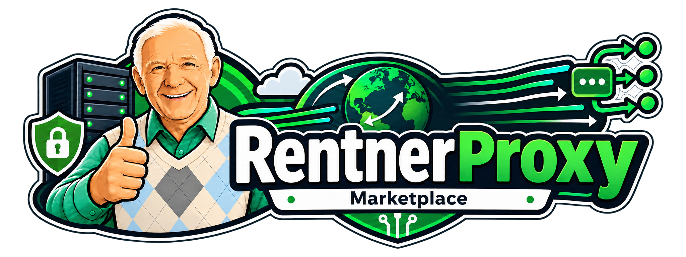

<p align="center">
    
</p>

<div align="center">

[](.github/workflows/ci.yml)
[](.github/workflows/dependency-security.yml)
[](.github/workflows/release.yml)

[](https://bun.sh/)
[](https://react.dev/)
[](https://www.typescriptlang.org/)
[](https://tailwindcss.com/)
[](LICENSE)

</div>

# <!-- project:defaultName -->RentnerProxy Marketplace<!-- /project -->

Grundlage des offiziellen RentnerProxy-Marketplace mit TanStack Start, React, TypeScript, Tailwind CSS und Rust-Core.

Projektangaben in `web/src/config/app.config.ts` anpassen und mit `bun run project:sync` übernehmen. Volume-Namen werden aus dem letzten Teil von `imageRepository` abgeleitet; diesen bei bestehenden Installationen beibehalten.

## Voraussetzungen

- Bun ab 1.4.4; die Projektversion steht in `package.json`. `bun run format` und `bun run format:check` verwenden den nativen Formatter `bun fmt` mit den Einstellungen aus `bunfig.toml`.
- Rust 1.100.0 mit Cargo, rustfmt und Clippy für die lokale Entwicklung; im Produktionsimage ist der Core bereits enthalten.
- PostgreSQL und Valkey – möglichst aktuelle stabile Versionen.
- PostgreSQL-Tools `pg_dump` und `pg_restore` in der Hauptversion der Datenbank für Backups; im Produktionsimage enthalten.
- SMTP-Zugang für Systemmails.

## Installation

PostgreSQL und Valkey starten.

```bash
bun install
cp .env.dev.example .env.local
```

`.env.local` anpassen (Datenbank, Valkey, Verschlüsselungsschlüssel und SMTP). Valkey wird über `VALKEY_URL` und `VALKEY_PASSWORD` konfiguriert; der Client verwendet `redis://` beziehungsweise `rediss://`. Danach:

```bash
bun run db:migrate
bun run dev
```

Die App läuft unter `http://localhost:3000`. Für den ersten Admin in einem zweiten Terminal `bun run setup:url` ausführen und den ausgegebenen Einmallink öffnen.

Für Produktion werden nur Docker Compose, `docker-compose.yml` und `.env` benötigt. Das vorgebaute Image bringt Webserver, Worker, PostgreSQL 18 und Valkey mit. `.env.example` als `.env` übernehmen und die zwölf vorgesehenen Werte anpassen: `ORIGIN`, Datenbankpasswort, Verschlüsselungsschlüssel und SMTP-Zugang; App-Port und Backup-Pfad besitzen bereits passende Vorgaben. `AUTH_ENCRYPTION_KEY` mit `openssl rand -base64 32` erzeugen.

```bash
docker compose pull
docker compose up -d
docker compose logs -f marketplace
```

Der Dienst <!-- project:applianceService -->`marketplace`<!-- /project --> veröffentlicht ausschließlich `${APP_PORT:-6600}`. Den Reverse-Proxy mit HTTPS auf diesen Port weiterleiten und dessen öffentliche Adresse als `ORIGIN` setzen. PostgreSQL, Valkey und die Prozesskonsole lauschen ausschließlich auf Loopback. Weitergereichte Client-IP-Header werden ohne konfigurierte Vertrauensstellung ignoriert; IP-Limits und Protokolle verwenden die direkte Gegenstelle.

Der Prozessmanager startet zuerst PostgreSQL und Valkey, wartet auf ihre Bereitschaft und startet anschließend Webserver und Worker. Die bereits vorhandene App-Initialisierung wendet vor dem Webserverstart ausstehende Migrationen an und synchronisiert Standardrechte; der Worker startet erst nach erfolgreicher App-Bereitschaft. Healthchecks prüfen alle vier Dienste. Fällt ein benötigter Prozess aus, beendet sich das gesamte Image mit Fehlerstatus und Docker startet es gemäß `unless-stopped` neu. Beim Stoppen werden zuerst Webserver und Worker beendet; PostgreSQL und Valkey bleiben während des Job-Drains verfügbar. Die feste Stoppschonfrist von `4h10m` schützt laufende Backups und Wiederherstellungen.

Für den ersten Admin den neuesten Setup-Link aus den Containerlogs vollständig im Browser öffnen. Der Link gilt zehn Minuten und wird bis zur ersten Benutzeranlage automatisch erneuert. Danach wird kein Setup-Link mehr erzeugt.

Das Volume <!-- project:dataVolume -->`marketplace_data`<!-- /project --> enthält PostgreSQL unter `/data/postgresql/18/docker` und öffentliche/private App-Dateien unter `/data/storage`. Backups liegen unter `/data/backups` und werden durch `BACKUP_PATH=./backups` auf dem Host gespeichert. Der Container richtet ausschließlich seine festen Unterverzeichnisse ein; vorhandene Dateien werden nicht rekursiv umberechtigt. App und Worker laufen als `bun` (UID 1000), PostgreSQL und Valkey unter eigenen Benutzern. `root` verwaltet den Start und reicht die Dienste an diese Benutzer weiter. Den Backup-Hostpfad und den Verschlüsselungsschlüssel zusätzlich außerhalb des Hosts sichern.

Bei Updates `.env`, Schlüssel und Volumes beibehalten, ein vollständiges Backup prüfen und anschließend `docker compose pull && docker compose up -d` ausführen. Ein Image-Rollback nimmt Schemaänderungen nicht zurück. PostgreSQL bleibt auf Major 18; fremde Major-Versionen und unvollständige Datenverzeichnisse werden abgewiesen. Valkey bleibt flüchtig: Offene Setup- und Verifikations-Flows beginnen nach Datenverlust neu; Queues und Zeitpläne werden aus den dauerhaften App-Daten abgeglichen. Die vollständige Betriebs- und Umstiegsanleitung steht in [docker/README.md](docker/README.md).

## Features

- Login, Logout und Passwort-Reset
- Zwei-Faktor-Authentifizierung, Passkeys und vertrauenswürdige Geräte
- Benutzerverwaltung, Einladungen und Berechtigungen
- Admin-Dashboard mit kompakten Dienstgruppen und schreibgeschützten Live-Konsolen für Webserver, WebSocket-Server, Worker, PostgreSQL, Valkey und Rust-Core
- Automatische Backups und Wiederherstellung
- Audit-Logs, Mail-Queue und Hintergrundjobs
- Realtime-Updates über WebSockets
- Deutsch/Englisch und anpassbares Design

Die Dashboard-Konsolen zeigen pro Dienst bis zu 300 stdout-/stderr-Zeilen und bestätigte Statusprüfungen und aktualisieren alle zwei Sekunden. Bei geöffnetem Dashboard wird der geprüfte Zustand sofort, bei Änderungen und ansonsten einmal pro Minute protokolliert, auch wenn der Dienst keine eigene Ausgabe erzeugt. Der Prozessmanager stellt für die Containerausgabe eine interne, ausschließlich lesbare Loopback-Schnittstelle bereit; ein Docker-Socket oder weiterer Container ist nicht erforderlich. Superuser-Prüfung, feste Dienstauswahl und Bereinigung bekannter Geheimnisfelder, Setup-Tokens und sensibler PostgreSQL-Folgezeilen bleiben erhalten. Der Puffer liegt begrenzt im Arbeitsspeicher und beginnt beim Containerneustart neu. Im Entwicklungsbetrieb zeigt die Konsole lokale Anwendungs- und Statusereignisse.

## Rust-Core

Kurze Core-Aufträge verwenden private, wiederverwendbare stdin/stdout-Worker mit höchstens vier Prozessen je Binärdatei und begrenzter Warteschlange. Die Grenzwerte und zulässigen Operationen stehen in `web/src/config/core.config.ts`. Jeder Auftrag prüft seine Dateisystemgrenzen erneut und besitzt eine eigene Abbruchsteuerung.

Hintergrundbilder werden im Worker-Kanal als begrenzte binäre Antwort bis 8 MiB übertragen; Lesen und Legacy-Migration bleiben im Rust-Core. Ein `binaryResult`-Header enthält die Auftrags-ID und die exakte Byteanzahl, gefolgt von den unveränderten Dateibytes. Eine leere Datei ist von einer fehlenden Datei (`null`) unterscheidbar. Erst der vollständige Payload bestätigt den Abschluss. Fragmentierte, widersprüchliche oder unvollständige Antworten werden verworfen und führen zu keiner automatischen Wiederholung. Die bestehenden JSON-/Base64-Operationen bleiben kompatibel.

Branding überträgt Logo, kleines Logo und Favicon in einem binären Auftrag mit drei geprüften Längen: höchstens 8 MiB je Variante und 24 MiB insgesamt, innerhalb des gemeinsamen Pool-Speicherlimits. Rust validiert alle Varianten vor der ersten Veröffentlichung und nutzt denselben abgesicherten Staging-Ablauf wie die bisherige JSON-Schnittstelle. Die private Worker-Erweiterung bleibt additiv zu Protokoll 1; Web und Core werden gemeinsam gebaut und ausgeliefert.

Backup-Dateien löscht der Core über frische, nicht Symlinks folgende Verzeichnishandles mit Inodeprüfungen und Verzeichnis-Synchronisierung. Retention bündelt Katalogreferenzen derselben Archivdatei; SQL, Berechtigungen und Audit bleiben in TypeScript. Ein exklusiver [PostgreSQL-Tabellenlock](https://www.postgresql.org/docs/18/explicit-locking.html) schützt die Referenzprüfung bis zum Commit vor konkurrierenden Änderungen. Jede Transaktion löscht höchstens eine physische Datei. Ein späterer DB-Commitfehler kann das bereits bestätigte Unlink weiterhin nicht zurückrollen. Nach einer unvollständig bestätigten Löschung erfolgt keine automatische Wiederholung. Die privaten Backup-Verzeichnisse setzen kooperierende Dienste desselben Betriebssystembenutzers voraus; eine atomare Kombination aus Inodevergleich und Unlink bietet das Dateisystem-API nicht.

Einzelne private Dateien ab 4 MiB bis zum Limit von 8 MiB schreibt Bun unter Linux x64/arm64 direkt. Kleinere Dateien bleiben auf dem gemessenen schnelleren Core-Pfad; die Grenze steht in `web/src/config/private-storage.config.ts`. Ein Descriptor-Adapter bindet alle Pfadoperationen über das echte `/proc/self/fd` an geöffnete Verzeichnisse; Symlink-Schutz, private Rechte, atomisches Ersetzen und Datei-/Verzeichnis-Synchronisierung bleiben erhalten. Höchstens vier direkte Schreibvorgänge sind aktiv; aktive und wartende direkte Aufträge teilen die Grenzen von 32 Aufträgen und 64 MiB einschließlich Metadaten, getrennt von den Core-Pools. Eingaben werden vor dem ersten Await kopiert und nach vollständigem Abschluss gelöscht. Abbrüche wirken kooperativ vor der Veröffentlichung; bereits laufendes Datei-I/O wird vor der Rückgabe vollständig abgewartet und besitzt keinen eigenen beendbaren Prozess. Auf anderen Plattformen oder bei fehlendem procfs vor der ersten Mutation übernimmt der Rust-Core die binären Dateidaten. Fehler nach Beginn der Mutation lösen keine Wiederholung aus.

Lange Aufträge, blockierende Sperren und explizite Prozessumgebungen behalten eigene Prozesse. Die Restore-Journal-Sitzung bleibt separat. Unsichere Mutationen werden niemals automatisch wiederholt. Nitro und der Hintergrund-Worker warten beim Herunterfahren zuerst auf direkte Schreibvorgänge und schließen danach ihre Core-Pools; kurzlebige Bun-Prozesse räumen Core-Pools beim natürlichen Ende auf.

Beim Performancevergleich mit dem letzten Stand ohne Rust (`8e81ff6`) sind unterschiedliche Durabilitätsgarantien zu beachten: Der damalige TypeScript-Schreibpfad synchronisierte die Datei, aber nicht das Zielverzeichnis nach der Umbenennung. Der aktuelle Pfad synchronisiert beides. Die zusätzliche Verzeichnis-Synchronisierung ist nötig, weil ein [Datei-`fsync` den Verzeichniseintrag nicht automatisch dauerhaft speichert](https://man7.org/linux/man-pages/man2/fsync.2.html). Sie bleibt auch bei Performanceoptimierungen erhalten.

Große binäre Nutzdaten werden bei leerem Lesepuffer direkt in den löschbaren Zielpuffer gelesen. Vorhandene Verzeichnisse werden zuerst ohne Symlink-Folgen geöffnet und nur bei fehlendem Eintrag angelegt. Bei Archivextraktionen synchronisieren höchstens vier Threads bereits beschriebene Dateien parallel; zusätzlich bleibt höchstens die aktuell geschriebene Nutzdatei offen. Jeder Rückweg wartet auf alle gestarteten Synchronisierungen und schließt deren Handles, bevor die Aufrufer aufräumen. Erfolg setzt weiterhin `sync_all` für jede Nutzdatei sowie die abschließenden Integritäts-, Quellidentitäts- und Abbruchprüfungen voraus.

`bun run core:format:check`, `bun run core:lint` und `bun run core:coverage` prüfen Rust einschließlich des 90-%-Coverage-Gates. `bun run test:core-integration` prüft die echte Web/Core-Grenze. Rust-Tests liegen ausschließlich unter `core/tests/`.

## Feature-Struktur

`web/` enthält TypeScript-Quellcode, öffentliche Assets und den unverändert
verschobenen Drizzle-Ordner. `core/` enthält Cargo und die nativen Programme
für Archive, Storage, PostgreSQL-Werkzeuge und den Appliance-Prozessmanager.
Manifest, Bun-Lockfile, Web-Konfiguration und `drizzle.config.ts` bleiben im
Root. Die Zuständigkeiten, Dependency-Entscheidungen und Prüfkommandos stehen
in [core/README.md](core/README.md).

```text
web/src/features/<Bereich>/<Feature>/
├── Components/    # UI-Komponenten
├── Types/         # Typen und Verträge
├── Hooks/         # use...Logic: state, handler, optional setter/refs/form/table
├── index.tsx      # Seite
├── middleware.ts  # Validierung, Autorisierung und Service-Aufruf
└── validation.ts  # Zod-Validierung
```

Ordner und Dateien nur bei Bedarf anlegen; größere Komponenten bündeln eigene Hooks und Types unter `Components/<Name>/`. Views enthalten JSX, die Logik liegt in Hooks. Backendlogik liegt in `web/src/server`, UI-freie Helfer in `web/src/lib`, gemeinsame UI in `web/src/shared`; Tests spiegeln diese Pfade unter `web/src/tests`. Öffentliche Seiten verwenden `PublicLayout`, geschützte `AuthenticatedLayout`. Referenz: `web/src/features/Admin/PermissionManagement`.

## Lizenz

MIT
